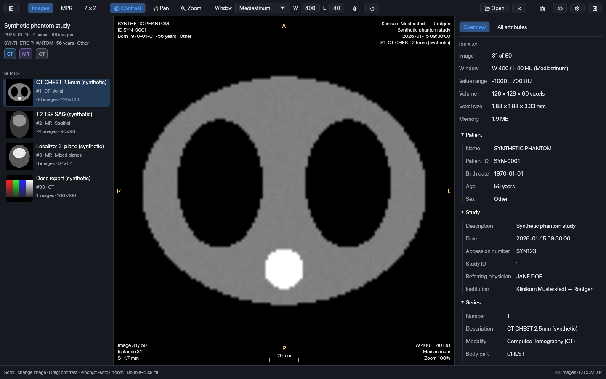
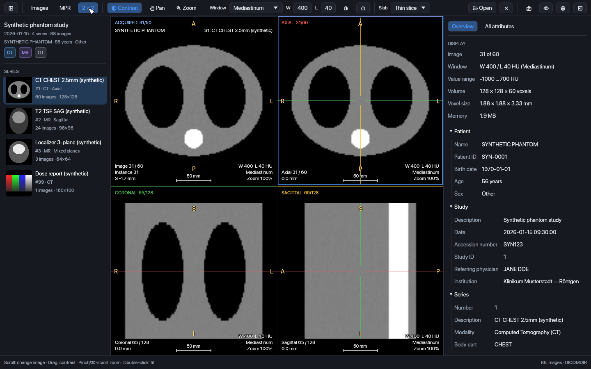
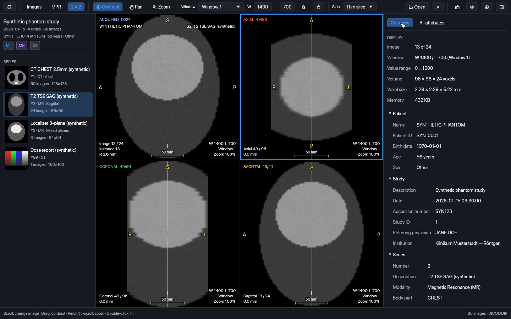

# SumMRIse

A native desktop viewer for the **MRI and CT scans hospitals give patients on CDs, DVDs
and USB sticks**. Open the disc, see every series in the correct anatomical
orientation, adjust contrast with clinical presets, reformat volumes into axial, coronal
and sagittal planes (with MIP), and read every acquisition parameter in plain language.

Runs on **macOS** (Apple Silicon and Intel, macOS 11+), **Windows** and **Linux** from a
single Rust code base. Everything happens on your computer — nothing is uploaded.

> **SumMRIse is not a medical device.** It is intended for personal and educational
> viewing and must not be used for diagnosis. Discuss your images with your doctor.



| Multiplanar reformatting (2 × 2) | Sagittal MR with reformats |
| --- | --- |
|  |  |

*Screenshots use the synthetic phantom from `crates/testkit`; no real patient data.*

## Features

- **Opens patient media the standard way** — reads the `DICOMDIR` index (PS3.10/12),
  ignores the viewer software and autorun files on the disc, falls back to a folder
  scan, resolves ISO 9660 file names, detects inserted discs automatically.
- **Correct images** — dicom-rs 0.10 decoding of uncompressed, deflate, JPEG
  (baseline/extended/lossless), JPEG 2000 and RLE data; Hounsfield units for CT;
  MONOCHROME1/2 and colour; multi-frame and Enhanced multi-frame geometry.
- **All projections** — acquired images in their own plane plus axial, coronal and
  sagittal reformats in radiological orientation for any acquisition plane (also
  oblique and gantry-tilted CT), linked crosshair, MIP/MinIP/average slabs.
- **Contrast** — DICOM VOI functions (LINEAR, LINEAR_EXACT, SIGMOID), windows stored by
  the scanner, 11 clinical CT presets, robust auto window, drag/numeric adjustment, invert.
- **Metadata** — curated overview (patient, study, series, equipment, MR/CT acquisition
  parameters with units, image geometry) and the complete searchable attribute tree.
- **Private by default** — no network access, no image cache on disk, privacy mode for
  screenshots, minimal recent-studies list.
- **Modern, accessible UI** — dark/light themes, platform fonts, keyboard shortcuts,
  screen-reader labels, trackpad gestures, drag and drop.

## Download and build

Prerequisite: [rustup](https://rustup.rs). The exact toolchain (Rust 1.99.1) is pinned
in `rust-toolchain.toml` and installs itself on first use.

```bash
cargo run --release -p summrise                 # run the app
cargo run --release -p summrise -- /Volumes/CD  # open a disc/folder directly
```

### macOS app bundle

```bash
cargo xtask bundle-macos --universal --dmg
```

Produces `dist/macos/SumMRIse.app` (universal arm64 + x86_64, ad-hoc signed, hardened
runtime) and `dist/macos/SumMRIse-<version>-macos-universal.dmg`. Developer ID signing
and notarization: see [packaging/macos/README.md](packaging/macos/README.md).

### Windows and Linux

```bash
cargo build --release -p summrise
```

Linux needs the usual X11/Wayland development packages (Debian/Ubuntu:
`libxkbcommon-dev libwayland-dev libx11-dev libxcursor-dev libxrandr-dev libxi-dev libgl1-mesa-dev`).
Desktop entry and AppStream metadata live in `packaging/linux`. CI builds a Windows zip
and a Linux tarball; installers (MSI, AppImage, Flatpak) are planned — see the plan below.

## Using SumMRIse

| Action | Mouse / trackpad | Keyboard |
| --- | --- | --- |
| Next / previous image | scroll, two-finger swipe | ↑ ↓ ← →, Page Up/Down (±10), Home/End |
| Contrast (window/level) | drag with *Contrast* tool, or right-drag | presets 1–9, A = auto, R = reset, I = invert |
| Zoom | pinch, ⌘/Ctrl-scroll, *Zoom* tool | double-click = fit |
| Pan | middle-drag, Shift-drag, *Pan* tool | |
| Move crosshair (MPR) | click | |
| Layouts | toolbar *Images / MPR / 2 × 2* | M toggles MPR |
| Panels | | ⌘B browser, ⌘I inspector, O annotations, ⌘, settings, ⌘O open |

## Architecture

```text
sumMRIse/
├── apps/desktop/        summrise binary: window, logging, CLI argument
├── crates/
│   ├── imaging/         pure maths: LPS geometry, volumes, MPR, VOI windowing
│   ├── dicom/           DICOM I/O (dicom-rs): DICOMDIR/scan, indexing, decoding, metadata
│   ├── core/            UI-agnostic app layer: session, background jobs, view state, settings
│   ├── ui/              egui/eframe interface (wgpu → Metal / DirectX 12 / Vulkan)
│   └── testkit/         synthetic, PHI-free DICOM CDs for tests and QA
├── xtask/               cargo xtask: icons, bundle-macos, fixtures, ci
├── packaging/           macOS Info.plist & icns, Windows ico, Linux desktop/AppStream
└── openspec/            specification-driven change plan (see below)
```

Dependencies point one way: `imaging ← dicom ← core ← ui ← apps/desktop`. Only `ui` and
the binary know about egui, so the domain layers can be reused by another front-end
(for example a native SwiftUI shell via FFI) without changes. Why one cross-platform UI
instead of a different stack per platform, and why egui rather than Qt, GTK, Tauri or
Slint, is documented in
[openspec/changes/restructure-monorepo/design.md](openspec/changes/restructure-monorepo/design.md).

## Development

```bash
cargo xtask ci                      # fmt check + clippy -D warnings + all tests
cargo test --workspace              # unit, integration and offscreen UI tests
cargo xtask fixtures /tmp/test-cd   # write a synthetic patient CD for manual testing
cargo xtask icons                   # regenerate app icons
SUMMRISE_SNAPSHOT_DIR=/tmp/shots cargo test -p summrise-ui --test smoke   # keep UI renders
```

Never commit real imaging data — `.gitignore` blocks `DICOMDIR` and `*.dcm`; use the
testkit fixtures instead. Licences and advisories are checked with `cargo deny check`.

## Plan (OpenSpec)

Work is organised as [OpenSpec](https://github.com/Fission-AI/OpenSpec) changes
(`openspec list`, `openspec show <change>`; in Claude Code use `/opsx:propose`,
`/opsx:apply`, `/opsx:archive`). Shipped changes are archived in
`openspec/changes/archive/`, and their requirements form the baseline specifications in
`openspec/specs/`: build system, application shell, DICOM import, image decoding, image
viewing, contrast windowing, metadata inspector, privacy, macOS packaging and continuous
integration.

**Shipped** (PR #1, archived 2026-11-05): `restructure-monorepo`,
`adopt-cross-platform-ui`, `dicom-media-import`, `image-decoding-and-volumes`,
`multiplanar-viewing`, `contrast-windowing`, `metadata-inspector`, `privacy-safeguards`,
`macos-distribution`, `ci-quality-gates`.

**Planned — viewing features** (from a comparison with professional viewers; suggested
order as listed, `series-comparison` before `measurement-tools`):

| Change | Scope |
| --- | --- |
| `progressive-loading` | Show images while a series loads; load around the image being viewed |
| `report-viewer` | Structured reports, PDF and text documents, dose reports |
| `series-comparison` | Side-by-side layouts, synchronised scrolling, cross-reference lines, compare studies |
| `measurement-tools` | Length, angle and region statistics, presented as approximate |
| `export-and-share` | Save and copy views, export a series as images, private by default |

**Planned — releases and platforms:**

| Change | Scope |
| --- | --- |
| `signed-releases` | Developer ID signing and notarization, Intel check, tagged GitHub Releases with checksums, no-network dependency gate |
| `macos-integration` | Native menu bar; open folders from the Dock and Finder ("Open With") |
| `jpeg-ls-support` | JPEG-LS decoding (CharLS) in release builds |
| `field-validation` | Real vendor CDs, screen readers, usability sessions, log privacy review |
| `windows-distribution` | Executable resources, MSI installer, Authenticode signing; re-enable the Windows CI check (paused to save CI time) |
| `linux-distribution` | AppImage and Flatpak |

Later ideas (not yet proposed): cine and multi-phase series, oblique reformats, 3D
volume rendering, opening ZIP and ISO downloads, de-identified DICOM export, a
plain-language guide to series and parameters, translations, PET uptake values, and —
only with de-identification and explicit consent — AI explanations.

## Licence

MIT — see [LICENSE](LICENSE). Third-party crates are permissively licensed (checked by
`cargo deny`); platform UI fonts are loaded from the operating system at run time.
